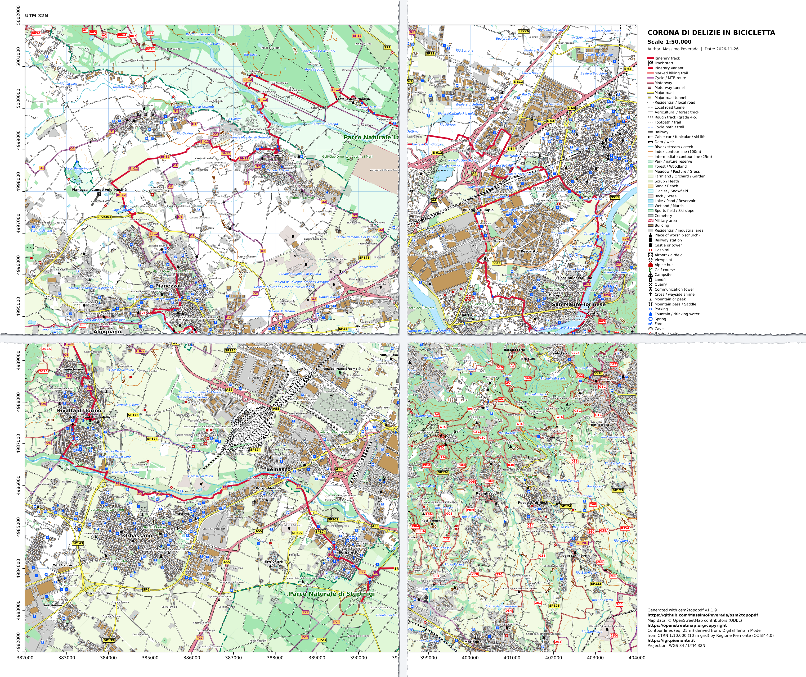

<p align="center">
  
</p>

# osm2topopdf

**Topographic Georeferenced PDF Map Generator from OpenStreetMap Data and GPX Tracks**

Utility by **Massimo Peverada** to make a georeferenced PDF from OSM data, given one or more GPX tracks. Based on my private FreeBASIC utility to convert OSM to DXF, ported to Python and developed with the help of Gemini.

Released under the **GNU General Public License v3.0 (GPLv3)**.


## Sample Map Output

<p align="center">
  <a href="assets/demo_corners.png">
    
  </a>
  <br>
  <em>Click the image to view full resolution (four corners showing UTM axis ticks, GPX track styling, legend, and clickable data credits).</em>
</p>

---

## Features

- **Cartographic TOPO Styling:** Renders landcover polygons, buildings, road hierarchies, rough/forest tracks with parallel edges, marked hiking and MTB/cycle trails, railways, aerialways, waterways, and custom vector symbols.
- **Georeferenced PDF Output:** Embeds ISO 32000 geospatial metadata (`EPSG` / `WKT` / `Viewport`) directly into the output PDF, ready for mobile GPS apps (e.g., Avenza Maps, Locus Map, QField) and GIS software.
- **Contour Lines from DTM or OSM:** Generates smooth index and intermediate contour lines directly from ESRI ASCII Grid (`.asc`) Digital Terrain Models (single file or multi-tile folder) or loads pre-existing OSM contour files.
- **Fast OSM Clipping:** Integrates `pyosmium` (including C++ `-fast` and single-pass `-superfast` modes) to extract the required bounding box directly from large `.osm.pbf` extracts.
- **Smart Label & Symbol Placement:** Priority-based classification engine with 400 m deduplication, border clipping, and bounding-box collision avoidance.
- **Multilingual Legend & Axes:** Defaults to English (`-lang en`), with built-in support for Italian (`-lang it`), French (`-lang fr`), German (`-lang de`), and Spanish (`-lang es`), plus easy extensibility to other languages.
- **Automatic UTM Zone Detection:** Automatically selects the appropriate WGS 84 UTM zone from the GPX track centroid (or accepts a manual zone such as `32N` or `19S`).
- **Configurable UTM Coordinate Grid:** Displays 1,000 m UTM axis ticks along the map frame, with optional internal coordinate grid lines toggleable via `grid = on/off` in `osm2topopdf.ini`.
- **GPX Track & Start Marker:** Draws the primary GPX route along with optional dashed red variants (`-trackvar`) and automatically places a checkered flag icon at the first point of the main track to highlight the starting location.

---

## Requirements & Installation

Requires **Python 3.10 or higher** (tested on Python 3.13).

1. **Download the repository:**
   * **Option A (ZIP download – no Git required):** Click the green **Code** button at the top of the GitHub page -> **Download ZIP**, extract it to a local folder (e.g., `C:\osm2topopdf`), and open a terminal inside that folder.
   * **Option B (using Git):**
     ```cmd
     git clone https://github.com/MassimoPeverada/osm2topopdf.git
     cd osm2topopdf
     ```
     *(To install Git on Windows via terminal:
     winget install --id Git.Git -e --source winget    
     After installation, close and reopen Command Prompt or PowerShell so Windows recognizes the new git command.)*

2. *(Recommended)* **Create and activate a virtual environment** to avoid system permission errors (`PermissionError: [Errno 13]` on Windows 11 / Linux / macOS):
   * **Windows (Command Prompt):**
     ```cmd
     python -m venv venv
     venv\Scripts\activate
     ```
   * **Linux / macOS:**
     ```bash
     python3 -m venv venv
     source venv/bin/activate
     ```
     *(Note for Debian/Ubuntu Linux: if `venv` or `pip` is missing, run `sudo apt install python3-venv python3-pip` before creating the virtual environment.)*

3. *(Optional)* **Ensure `pip` is installed** (if missing inside your environment):
   * **Windows:**
     ```cmd
     python -m ensurepip --upgrade
     ```
   * **Linux / macOS:**
     ```bash
     python3 -m ensurepip --upgrade
     ```

4. **Install the required Python libraries:**
   ```cmd
   pip install -r requirements.txt
   ```

---

## Quick Start

*(Note: On Linux/macOS, replace `python` with `python3` if you are not running inside an activated virtual environment.)*

### 1. Basic map from an already clipped `.osm` file
```bash
python osm2topopdf.py -track my_hike.gpx -outosm area.osm -outpdf my_hike.pdf
```

### 2. Clip directly from a large `.osm.pbf` extract + generate DTM contours
```bash
python osm2topopdf.py -track my_hike.gpx -inosm region-latest.osm.pbf -outosm area.osm -dtm ./dtm_folder -fast -outpdf my_hike.pdf
```

### 3. Generate a map with Italian legend and axis labels (`-lang it`)
```bash
python osm2topopdf.py -track my_hike.gpx -outosm area.osm -lang it -title "MONTE ROSA TOUR" -author "Massimo Peverada" -outpdf my_hike_it.pdf
```

### 4. Include route variants and custom scale
```bash
python osm2topopdf.py -track main_route.gpx -trackvar variant1.gpx variant2.gpx -scale 15000 -outpdf detailed_map.pdf
```

---
## Command-Line Options

Running `python osm2topopdf.py` with no arguments prints the full help message and creates a default `osm2topopdf.ini` configuration file if one does not exist.

### Input & Output Files

| Option | Default | Description |
| :--- | :--- | :--- |
| `-track <file>` | `track.gpx` | Main GPX track file to display on the map (also accepted as a positional argument). |
| `-trackvar <files...>` | *(none)* | One or more optional GPX route variant files, drawn as dashed red lines. |
| `-inosm <file>` | *(from INI)* | Full source OSM file (`.osm.pbf` or `.osm`). If specified, clips the map area using `pyosmium`. |
| `-outosm <file>` | `section.osm` | Clipped OSM file written by `pyosmium` (or read directly if `-inosm` is omitted). |
| `-outpdf <file>` | `topo_map.pdf` | Output georeferenced PDF filename. |
| `-config <file>` | `osm2topopdf.ini` | Path to the INI configuration file. |

### OSM Clipping Performance (`pyosmium`)

| Option | Default | Description |
| :--- | :--- | :--- |
| `-fast` | `False` | Uses native C++ `pyosmium` filters (`FileProcessor` + `IdFilter`) for faster clipping. |
| `-superfast` | `False` | Single-pass clipping using `pyosmium` C++ `BackReferenceWriter` (fastest on large `.pbf` files). |
| `-force` | `False` | Overwrites an existing `-outosm` file without asking for confirmation. |

### Elevation & Contour Lines

| Option | Default | Description |
| :--- | :--- | :--- |
| `-dtm <path>` | *(from INI)* | **Recommended.** ESRI ASCII Grid (`.asc`) DTM file, folder of `.asc` tiles, or wildcard pattern to generate smooth contour lines. |
| `-dtmmain <meters>` | `100` | Elevation interval in meters for index (major) contour lines. |
| `-dtmsec <meters>` | `25` | Elevation interval in meters for intermediate (minor) contour lines. |
| `-contours <file>` | `contour_lines.osm` | *Optional / legacy.* Pre-generated OSM XML file containing contour ways tagged with `contour=elevation` and `ele=<meters>` (e.g., created with `phyghtmap`). Ignored if `-dtm` is provided, and safely skipped if the file does not exist. |

#### Supported DTM & Contour Format Specifications
- **DTM File Format (`-dtm`):** **ESRI ASCII Grid** (`.asc` / `.ASC`) with standard 6-line header (`ncols`, `nrows`, `xllcorner`/`xllcenter`, `yllcorner`/`yllcenter`, `cellsize`, `nodata_value`). Both dot (`.`) and comma (`,`) decimal separators are supported.
- **DTM Input Modes:** Accepts a single `.asc` file, a folder containing multiple `.asc` tiles (automatically mosaicked over the map bounding box), or a wildcard pattern (e.g., `./dtm/*.asc`).
- **DTM Coordinate Reference System (CRS):** Automatically reads accompanying `.prj` files and reprojects contours on the fly to match the map's UTM zone if needed (with empirical coordinate warnings when `.prj` is omitted).
- **Pre-generated OSM XML Contours (`-contours`):** Standard OSM XML (`.osm`) in WGS 84 (`EPSG:4326`) containing ways tagged with `contour=elevation`, `ele=<meters>`, and optional `contour_ext=elevation_major` / `elevation_minor` (e.g., generated with `phyghtmap` / `pyhgtmap`).

### Map Layout, Scale & Language

| Option | Default | Description |
| :--- | :--- | :--- |
| `-scale <int>` | `25000` | Cartographic scale denominator, between `5000` and `75000` (e.g., `25000` for 1:25,000, `50000` for 1:50,000). |
| `-pad <meters>` | `500` | Minimum buffer around the GPX track in meters (automatically rounded outward to 1,000 m grid lines). |
| `-symscale <val>` | `auto` | Scale factor for symbols, labels, and road/line widths (`auto` adjusts automatically with `-scale`, or pass a number like `0.8` or `1.2`). |
| `-utm <zone>` | `auto` | WGS 84 UTM zone (`auto` detects from GPX centroid, or specify e.g. `32N`, `33N`, `19S`). |
| `-lang <code>` | `en` | Language code for legend, axes, and PDF metadata (`en` built-in; `it`, `fr`, `de`, `es` included via `lang_<code>.json`). Falls back to `en` if the file is missing. |
| `-title <text>` | *(GPX filename)* | Title printed at the top of the legend. |
| `-author <text>` | *(from INI)* | Author name printed below the scale. |
| `-date <text>` | *(today)* | Date printed in the legend (pass `""` to omit). |

### Filtering & Custom Overrides

> [!WARNING]
> **Browser Auto-Translation Notice:** If you have automatic page translation enabled in your browser, **do not copy and paste** the contents of `.txt` configuration files (`names.txt`, `osmfilters.txt`, `labels.txt`) directly from the rendered GitHub page, as keywords and OSM tags may get translated and break rule parsing. Always download the files directly or use the **Raw** button on GitHub.

| Option | Default | Description |
| :--- | :--- | :--- |
| `-exclude <file>` | `names.txt` | Optional text file to hide unwanted labels via text rules (`begins: text`, `equals: text`, `contains: text`) or OSM tag/area rules (`@exclude: key=val1,val2` with optional area filter). |
| `-labels <file>` | `labels.txt` | Optional file for custom label coordinates, offsets, or priority overrides. |
| `-filters <file>` | `osmfilters.txt` | Optional file to completely hide OSM features (node icons, ways, or polygons) matching tag, area, and scale rules (`key1=val1,val2; key2=val3; area < 1000; scale > 25000`), while keeping structural nodes intact. |

---

#### Geometric & Scale Feature Filters (`osmfilters.txt`)

You can hide entire OSM elements (node icons, ways, or polygons) in `osmfilters.txt` (or any file passed via `-filters`) using semicolon-separated `AND` rules and comma-separated `OR` values. Filtered nodes remain in memory so connected ways and polygons stay intact, while `area` conditions are automatically ignored on non-polygon elements:

    ' Hide aerialways / ski lifts
    aerialway=*

    ' Hide small first-aid hospital buildings or POIs
    amenity=hospital; emergency=first_aid; area < 1000

    ' Simplify urban clutter at overview scales (> 1:25,000)
    building=*; area < 40; scale > 25000
    highway=service; scale > 35000

---

#### Custom Label Rules (`labels.txt`)

You can customize label text, coordinates, offsets, and rendering priority in `labels.txt` (or any file passed via `-labels`). Lines starting with `'` are treated as comments, and multiple tags can be combined inside the same `ifname` block.

- **Abbreviate or rename a label** (optionally restricted to a specific feature category via `ificon` such as `cycle_route`, `hiking_route`, `road`, `peak`, `hut`, `saddle`, `spring`, `viewpoint`, `castle`, or `church`):
  ```xml
  ' Shorten a long cycle route label
  <tag k="ifname" v="Via della Pietra"/>
  <tag k="ificon" v="cycle_route"/>
  <tag k="replacename" v="VP"/>
  ```

- **Shift label coordinates by a relative offset** (in projected UTM meters):
  ```xml
  ' Shift a peak label 120 m East and 80 m North to avoid overlapping a ridge
  <tag k="ifname" v="Monte Rocciamelone"/>
  <tag k="offsetlon" v="120"/>
  <tag k="offsetlat" v="80"/>
  ```

- **Pin a label to exact projected UTM coordinates:**
  ```xml
  <tag k="ifname" v="Colle del Lys"/>
  <tag k="setlon" v="376450"/>
  <tag k="setlat" v="5004200"/>
  ```

- **Override rendering priority** (higher values win collision checks; e.g., `200` forces a label to always be drawn above cities `180`, peaks `87`, and routes `8–10`):
  ```xml
  ' Ensure a key shelter or trail marker is never hidden by nearby labels
  <tag k="ifname" v="Rifugio Rocciamelone"/>
  <tag k="priority" v="200"/>
  ```

---

## Configuration File (`osm2topopdf.ini`)

On first run, `osm2topopdf` generates `osm2topopdf.ini` in the working directory. You can store your recurring paths (such as your regional `.osm.pbf` extract, local DTM folder, default language, author name, and map credits) there so you don't have to type them every time. Command-line flags always override INI values.
* **Multilingual Credits (`text_<lang>`):** Define language-specific credit blocks (e.g., `text_it`, `text_fr`) in `[CREDITS]`, selected via `-lang <code>` or INI settings with a fallback to `text`.
* **Clickable Hyperlinks:** URLs or Markdown links (`[Label](https://...)`) in `[CREDITS]` render as clickable hyperlinks in the PDF.

---

## Adding a New Language

English strings are built into `i18n.py`. To add another language (for example, Portuguese `pt`):
1. Copy `lang_it.json` to `lang_pt.json` in the same directory as `osm2topopdf.py`.
2. Translate the values while keeping the JSON keys unchanged.
3. Run the tool with `-lang pt` (or set `lang = pt` in `osm2topopdf.ini`).

---

## Project Structure

- `osm2topopdf.py` – Main CLI entry point, GPX loader, `pyosmium` clipper, and georeferenced PDF builder
- `i18n.py` / `lang_*.json` – Internationalization loader and translations (`it`, `fr`, `de`, `es`)
- `osm_loader.py` – OSM XML/PBF parser, multipolygon assembler, and spatial clipper
- `dtm_contours.py` – Multi-tile ESRI `.asc` DTM reader with `.prj` auto-reprojection and contour line generator
- `topo_polygons.py` – Landcover, water, protected areas, and building renderer
- `topo_lines.py` – Roads, tracks, trails, railways, aerialways, waterways, and labeled contours renderer
- `topo_points_labels.py` – Symbol placement and collision-free label engine
- `topo_classifier.py` – OSM feature classification rules
- `topo_labels_config.py` – Font styles and priority definitions
- `topo_symbols.py` – Custom vector markers
- `legend.py` – Adaptive single/two-column topographic map legend
- `names.txt` – Sample universal OSM tag/area and text label exclusion rules
- `osmfilters.txt` – Sample geometric and scale-based OSM feature filter rules

---

## License & Data Attribution

- **Software:** Licensed under the GNU General Public License v3.0 (GPLv3).
- **OpenStreetMap Data:** Map features rendered by this tool come from OpenStreetMap (`© OpenStreetMap contributors`, licensed under the ODbL). Proper attribution to OpenStreetMap is mandatory when publishing or distributing generated maps.
- **Elevation Data (DTM):** Digital Terrain Models are not included in this repository. If you use external DTM files (`-dtm`) to generate contour lines, **you are responsible for complying with the provider's license terms and adding the required copyright notice** in the credits section of `osm2topopdf.ini` before distributing the resulting PDF maps.

---

## Disclaimer

**Use this utility at your own risk.**  
This software is provided "as is", without warranty of any kind, express or implied, in accordance with the GNU General Public License v3.0 (GPLv3).

The maps generated by `osm2topopdf` rely on crowd-sourced OpenStreetMap data and third-party elevation models, which may contain inaccuracies, omissions, or outdated information. **Do not rely solely on these maps for navigation, mountaineering, or outdoor safety.** Always verify routes on the ground, carry official cartography and proper navigation equipment, and check local trail and weather conditions before heading outdoors. The author assumes no responsibility or liability for any accidents, injuries, damages, or losses resulting from the use of this software or the maps it produces.

**No Affiliation:** `osm2topopdf` is an independent open-source project and is not affiliated with, endorsed by, or sponsored by the OpenStreetMap Foundation (OSMF), the Free Software Foundation (FSF), or any other third-party organization or data provider mentioned in this documentation. All trademarks and data copyrights belong to their respective owners.

## Getting OpenStreetMap Data (`.osm.pbf`)

To generate maps for your area, download a regional OpenStreetMap extract in `.osm.pbf` format from one of the free public mirrors:

- **Geofabrik Download Server:** `download.geofabrik.de` (organized by continent, country, and region — e.g., `italy-nord-ovest-latest.osm.pbf`)

Save the downloaded `.osm.pbf` file locally and pass it via `-inosm <file.osm.pbf>` (or set `inosm = ...` once in `osm2topopdf.ini`).

## Roadmap

Planned features and improvements for upcoming releases (v1.2.0+):

- **Garmin GPX Track Color Support & Legend Entries (`gpxx:DisplayColor`):** Automatically read `<gpxx:DisplayColor>` extensions and `<name>` labels from GPX tracks or segments (exported by Garmin BaseCamp, MapSource, or GPS devices) to render each route/segment in its assigned color and list its color swatch and name in the map legend, falling back to default styling when unspecified.
- **GeoTIFF DEM Support:** Add native support for `.tif` / `.tiff` Digital Elevation Models alongside ESRI ASCII Grid (`.asc`).
- **Additional Language Packs:** Community translations (e.g., Portuguese, Dutch, Polish) via `lang_<code>.json` files.

## Changelog

### v1.1.12 (2026-11-28)

- Prioritized primary POI roles (`historic=castle`, `tourism=alpine_hut`, `amenity=place_of_worship`, `railway=station`, etc.) over secondary `place=*` context tags during node classification (`topo_classifier.py`), preventing POI icons and compact labels from being overridden by large settlement/locality fonts.
- Updated `historic_castle` label styling to `Text4` (`topo_labels_config.py`) and added polygon classification support for `building=castle`, `amenity=castle`, and `building=alpine_hut` (`topo_classifier.py`).
- Added `"historic"` to closed-way polygon area tags and skipped `boundary=administrative` relations during OSM parsing (`osm_loader.py`) so standalone historic polygons render with their proper symbol and label without administrative boundary overhead.

### v1.1.11 (2026-11-27)

- Added geometric and scale-based OSM feature filtering (`osmfilters.txt` / `-filters`) to hide unwanted node icons, ways, or polygons using multi-tag `AND`/`OR` rules, polygon area thresholds, and map scale conditions (`scale > N` / `scale < N`) while keeping structural nodes intact.
- Extended `names.txt` (`@exclude:`) to support multiple semicolon-separated `AND` tag conditions and `scale` thresholds alongside polygon `area` filters.
- Added an early PDF maximum page dimension check (`5080 x 5080 mm` / `200 in` ISO 32000 limit) before OSM clipping, advising users to increase `-scale` or split oversized GPX tracks into smaller stages.
- Added automatic `.prj` projection detection and on-the-fly reprojection for `.asc` DTM files (`pyproj`), empirical coordinate congruence warnings when `.prj` is missing (WGS84 degrees, Gauss-Boaga, feet), and graceful warnings if `-dtm` paths or `.asc` tiles are missing.
- Improved vector rendering performance on large-format maps (e.g., 1:10,000) by disabling intermediate Matplotlib Agg canvas redraws during layer construction (`osm2topopdf.py`), preventing freezes and speeding up PDF generation up to 10x–30x.
- Documented the GPX start checkered flag marker and added a browser auto-translation warning for `.txt` configuration files in `README.md`.

### v1.1.10 (2026-11-26)

- Added clickable PDF hyperlinks and Markdown link support in legend credits (`legend.py`).
- Added multilingual credit block support (`text_<lang>`) in `osm2topopdf.ini` with `-lang` selection.
- Improved vertical spacing of legend header and credits across tall map formats (`legend.py`).
- Added configurable internal UTM grid lines (`grid = off` / `on` in `osm2topopdf.ini`, disabled by default for cleaner map readability; border UTM ticks preserved).
- Added sample four-corner map preview (`assets/demo_corners.png`) to `README.md`.

### v1.1.9 (2026-11-25)
- Added universal OSM tag and polygon area label filtering (`@exclude: key=val1,val2` with optional area filter) in `names.txt` (`-exclude`), hiding unwanted shop, restaurant, and small company labels while preserving building footprints and map symbols, plus an updated `names.txt` sample file in the repository root.
- Added line-numbered syntax validation warnings when loading `names.txt`.
- Added automatic case-insensitive file matching for CLI path arguments (`-track`, `-trackvar`, `-inosm`, `-dtm`, `-contours`, `-exclude`, `-labels`, `-config`) across both Windows and Linux.
- Enforced `-scale` range between `5000` and `75000` and extended `-symscale` proportional scaling to road, track, railway, and waterway widths (with slimmer `highway=service` styling to prevent parking-aisle clutter at 1:50,000).
- Increased label deduplication radius to `400 m` for cleaner maps at overview scales and added an early file-lock check when the output PDF is already open.
- Fixed localized date formatting when -date is omitted.

### v1.1.8 (2026-11-24)
- Added automatic topological closing of clipped multipolygons along the map bounding box (enabling full rendering of large rivers, forests, and parks even with `-fast` and `-superfast`).
- Updated hydrographic layer `zorder` so riverbank polygons cleanly cover river centerlines (`waterway=river`).
- Eliminated visible seam lines at joints between adjacent riverbank/water polygons while keeping crisp shoreline outlines.
- Filtered out urban `barrier=gate` nodes to reduce map clutter, keeping gates only along rural tracks, paths, and cycleways while preserving `lift_gate` and `swing_gate` barriers everywhere.
- Smoothed hiking and cycling route highlights using `linemerge` and butt capstyles to prevent opacity overlaps at segment joints.
- Added hidden `-debug` diagnostic flag for multipolygon inspection.

### v1.1.7 (2026-11-24)
- Initial public release.